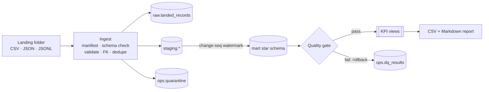

# Enterprise Data Pipeline — Manufacturing & Supply-Chain Analytics

[](https://github.com/imran-basha-data/enterprise-data-pipeline/actions/workflows/ci.yml)


A batch ELT pipeline that turns messy exports from ERP, MES, WMS and procurement systems into a tested PostgreSQL star schema and an operational KPI report. It is built to be **idempotent, incremental and recoverable**, and to **prove** its data-quality claims with tests.

> All data is synthetic and generated by the project itself. Company and supplier names are fictitious.

---

## The problem

A manufacturer needs answers to a few operational questions:

- Are we producing what we planned, on time, with acceptable scrap?
- Which suppliers deliver on time and in full (OTIF), and how late are the late ones?
- Where are we below reorder point, or already out of stock?

The source data is unreliable. It has naive local timestamps that cross a daylight-saving change, UK and ISO date formats, re-sent and out-of-order updates, duplicate events, broken references, truncated JSON lines, and columns that appear without warning. A dashboard built straight on top of it would be wrong without anyone noticing.

## What this project does

| Capability | How |
|---|---|
| Multi-format ingestion | CSV, JSON array and JSON Lines, ordered by entity dependency |
| Data contracts | types, required fields, ranges, enums, ID formats, foreign keys and cross-field rules for 6 entities |
| Standardisation | UTC timestamps (naive values read as Europe/London, including BST), UK/ISO dates, code normalisation |
| Quarantine | invalid rows kept with the original payload and **every** reason code; files with more than 25% bad rows rejected outright |
| Idempotency | SHA-256 file manifest, so rerunning never reloads a file, even under a new name |
| Incremental loads | version-guarded upserts, so late or out-of-order files can't roll data back; change-sequence watermarks feed the marts |
| Reliability | one transaction per file, retry with exponential backoff, advisory lock against concurrent runs, crashed-run detection |
| Dimensional model | type-1 dimensions, accumulating-snapshot facts for orders and shipments, transaction-grain stock movements |
| Quality gate | blocking staging↔mart reconciliation; the whole refresh rolls back if it fails |
| KPI reporting | plan attainment, scrap, on-time completion, supplier OTIF, lead time, defect rate, delay buckets, stock cover; CSV + Markdown |
| Packaging | multi-stage, non-root Docker image; Compose stack; CI with lint, strict typing, tests, security scans and an end-to-end Docker run |

## Architecture



More detail: [docs/architecture.md](docs/architecture.md) · [docs/database-schema.md](docs/database-schema.md) · [docs/design-decisions.md](docs/design-decisions.md)

## Tech stack

Python 3.11/3.12 · psycopg 3 (`COPY`, server-side upserts) · PostgreSQL 16 · SQL (window functions, `FILTER`, `ON CONFLICT`, advisory locks) · pytest + coverage · Ruff · mypy (strict) · Bandit · pip-audit · Gitleaks · Docker / Compose · GitHub Actions

## Quick start

**Docker only:**

```bash
git clone https://github.com/imran-basha-data/enterprise-data-pipeline.git && cd enterprise-data-pipeline
cp .env.example .env            # set POSTGRES_PASSWORD; on Linux also HOST_UID / HOST_GID
mkdir -p data/landing reports
docker compose --profile demo up --exit-code-from demo demo
cat reports/kpi_report.md
```

**Local Python:**

```bash
python3.12 -m venv .venv && source .venv/bin/activate
pip install -r requirements-dev.txt && pip install --no-deps -e .
cp .env.example .env            # point EDP_DATABASE_URL at PostgreSQL 16
set -a && source .env && set +a
edp generate && edp run && edp report
```

Full instructions and the CLI reference: [docs/setup.md](docs/setup.md).

## Example output

From [`docs/sample-results/kpi_report.md`](docs/sample-results/kpi_report.md), generated with `edp generate --seed 42`:

| KPI | Value |
|---|---|
| units_produced | 109,397 |
| plan_attainment_pct | 95.39 |
| scrap_rate_pct | 2.08 |
| on_time_completion_pct | 38.79 |
| supplier_otif_pct | 70.67 |
| avg_supplier_lead_time_days | 8.85 |
| stockout_positions | 18 |
| quarantine_rate_pct | 2.46 |

Run log for the same dataset: 15 files, 7,770 rows. 7,536 records loaded, 191 quarantined and 39 exact duplicates skipped. Every injected defect was caught under the correct reason code. A second run loaded 0 files. More real query output: [docs/example-queries.md](docs/example-queries.md).

## How reliability is achieved

| Risk | Mitigation | Proven by |
|---|---|---|
| Same file delivered twice | `(entity, sha256)` unique manifest | `test_rerun_is_idempotent`, `test_same_content_under_a_new_name_is_not_reloaded` |
| Old update arrives after a new one | `WHERE target.updated_at < EXCLUDED.updated_at` | `test_out_of_order_delivery_never_regresses_state` |
| Crash halfway through a file | one transaction per file | `test_crash_mid_file_rolls_back_that_file_and_rerun_recovers` (recovered state == clean run) |
| Database blip | retry with exponential backoff on a fresh connection | `test_transient_error_is_retried_without_duplicate_writes` |
| Two schedulers fire at once | session-level advisory lock | `test_concurrent_runs_are_prevented` |
| Marts drift from staging | reconciliation gate inside the refresh transaction | `test_quality_gate_blocks_inconsistent_marts` |
| Incremental logic diverges from a rebuild | — | `test_incremental_batches_equal_full_refresh` |
| Defects slip through, or valid rows get flagged | generator records injected defects | `test_pipeline_catches_exactly_the_injected_defects` |

## Testing

**127 tests** (unit + PostgreSQL integration), **96% branch coverage**. CI runs on Python 3.11 and 3.12 and **fails if any test is skipped**. KPIs are asserted against values worked out by hand. See [docs/testing.md](docs/testing.md).

```bash
export EDP_TEST_DATABASE_URL=postgresql://edp:<password>@localhost:5432/edp_test   # disposable
pytest --cov
```

## Project structure

```text
src/edp/
  contracts.py      # entity contracts: fields, keys, FKs, cross-field rules
  parsing.py        # type coercion, timestamp standardisation
  validation.py     # record validation, content hashing
  readers.py        # discovery, CSV/JSON/JSONL readers, schema drift
  ingest.py         # per-file transaction: raw, dedupe, upsert, quarantine
  transform.py      # watermark-based mart refresh
  quality.py        # dataset checks and the quality gate
  pipeline.py       # run orchestration, locking, retries
  reporting.py      # KPI CSV + Markdown
  generator.py      # synthetic data with a defect manifest
  sql/migrations/   # ops, raw, staging, mart, KPI views
  sql/transform/    # one SQL file per mart model
tests/unit/         # no database needed
tests/integration/  # PostgreSQL
docs/               # architecture, schema, dictionary, setup, testing, security, troubleshooting
```

## Known limitations

- **Batch, not streaming.** Files are processed when `edp run` is invoked; there is no built-in scheduler.
- **Type-1 dimensions.** Historical reports use the *current* product cost and supplier lead time. Point-in-time history (SCD2) is not implemented.
- **Late-arriving reference data.** A fact that references a product not yet loaded is quarantined as `orphan_reference`. It is not automatically re-processed when the product arrives later; the corrected record has to be re-delivered.
- **Single writer.** The change-sequence watermark relies on the advisory lock, so runs cannot be parallelised across workers.
- **Scale.** Bulk paths use `COPY` and set-based SQL, but the pipeline has only been run on datasets of a few thousand rows, not load-tested at production volume.
- **PostgreSQL only.** No Snowflake or BigQuery adapter. One couldn't be tested here, so none is claimed. [Design decision 10](docs/design-decisions.md#10-no-cloud-warehouse-adapters) lists what a port would involve.
- **Security hardening for production** (enforced TLS to the database, image scanning, secrets manager) is listed but not implemented. See [docs/security.md](docs/security.md).

## Documentation

| Document | Contents |
|---|---|
| [Architecture](docs/architecture.md) | data flow, layers, run lifecycle, failure modes |
| [Database schema](docs/database-schema.md) | every schema and table, ER diagram, KPI views |
| [Data dictionary](docs/data-dictionary.md) | field rules per source, reason codes, KPI definitions |
| [Setup](docs/setup.md) | Docker and local install, CLI, configuration |
| [Example queries](docs/example-queries.md) | real queries with real output |
| [Testing](docs/testing.md) | strategy, coverage, failure injection |
| [Design decisions](docs/design-decisions.md) | why each major choice was made, and its trade-offs |
| [Security](docs/security.md) | secrets, least privilege, containers, dependencies |
| [Troubleshooting](docs/troubleshooting.md) | common errors and fixes |

## Licence

[MIT](LICENSE) © 2026 Mohd Imran Basha
