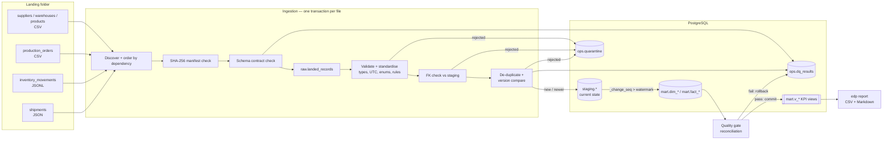

# Architecture

## Context

A mid-sized manufacturer runs three operational systems that each export data in their own way:

| Source system | Entity | Format | Quirks handled |
|---|---|---|---|
| ERP master data | suppliers, warehouses, products | CSV snapshots and deltas | whitespace, casing, re-sent unchanged rows |
| MES (shop floor) | production orders | CSV | **naive local timestamps** (Europe/London, incl. BST), status spelling variants |
| WMS | inventory movements | JSON Lines | mixed ISO / offset / epoch-ms timestamps, lower-case IDs, truncated lines |
| Procurement | inbound shipments | JSON array | ISO and UK `DD/MM/YYYY` dates, status updates re-sent in later batches, new columns appearing |

The pipeline turns these exports into a trustworthy analytical model and a KPI report. Operations, procurement and inventory teams can then answer:

- Are we producing what we planned, on time, with acceptable scrap?
- Which suppliers deliver on time and in full, and how late are the late ones?
- Where are we below reorder point or already out of stock?
- How much of the incoming data could not be trusted, and why?

## Data flow

## Layers

| Layer | Schema | Grain / purpose | Mutability |
|---|---|---|---|
| Manifest | `ops.ingested_files` | one row per file, unique on `(entity, checksum)` | insert once |
| Raw | `raw.landed_records` | every source row as JSONB, exactly as received | append-only |
| Staging | `staging.*` | typed, cleaned, current state per natural key | version-guarded upsert |
| Quarantine | `ops.quarantine` | rejected rows with payload and every reason | append-only |
| Marts | `mart.dim_*`, `mart.fact_*` | star schema for analytics | incremental upsert |
| KPIs | `mart.v_*` | metric definitions | views |
| Run metadata | `ops.pipeline_runs`, `ops.dq_results`, `ops.model_watermarks` | observability and recovery | per run |

## Run lifecycle

1. **Lock.** `pg_try_advisory_lock` on a dedicated session. A second concurrent run exits with code 3. Because the lock is tied to the session, a crashed process releases it automatically. Any run still marked `running` at this point must have crashed, so it is marked `abandoned`.
2. **Discover.** Files named `<entity>__<batch>.<csv|json|jsonl>` are ordered by entity dependency (suppliers/warehouses → products → transactional entities), then by name. Unknown files are logged and ignored.
3. **Ingest each file** in its own transaction, retried on transient errors:
   - Skip if `(entity, sha256)` is already in the manifest.
   - Reject the file if a required column is missing. Warn (or reject, by policy) on unexpected columns.
   - `COPY` all rows to `raw.landed_records`.
   - Validate each record. Cross-field rules run only when every field is valid, so each defect is reported once, by its root cause.
   - Check foreign keys against staging.
   - Resolve duplicates within the file and against staging (see below).
   - If more than `EDP_MAX_REJECT_RATE` of rows fail, reject the whole file and keep the quarantine evidence.
   - `COPY` winners into a temp table, then run one `INSERT … ON CONFLICT … WHERE target.updated_at < EXCLUDED.updated_at`.
4. **Publish models** in one transaction: refresh each model from its watermark, run the dataset checks, and commit only if no blocking check failed.
5. **Record** the run summary and every check result.

## Duplicate and version handling

| Situation | Outcome | Counted as |
|---|---|---|
| Same key, same content, twice in one file | keep one | `rows_duplicate` |
| Same key, same version, different content (in file or vs staging) | quarantine the later one | `duplicate_conflict` |
| Same key, older version (in file or vs staging) | skip | `rows_stale` |
| Same key, identical to staging | skip | `rows_unchanged` |
| Same key, newer version | update; `_change_seq` advances | `rows_updated` |
| Immutable event (inventory movement) re-sent with different content | quarantine | `duplicate_conflict` |

For every loaded file, `rows_read = inserted + updated + unchanged + stale + duplicate + quarantined`. A test asserts this.

## Incremental model refresh

Every staging insert or update takes a new value from the `staging.change_seq` sequence. Each mart model stores the highest sequence it has consumed in `ops.model_watermarks`. A refresh processes `(watermark, current_max]` and writes the new watermark **in the same transaction** as the model rows, so the marts and their bookmarks can never drift apart. The advisory lock guarantees a single writer, which keeps the sequence-based watermark safe.

A test loads three batches incrementally, then runs `--full-refresh`, and asserts the marts are identical.

## Failure modes and behaviour

| Failure | Behaviour |
|---|---|
| Database connection drops mid-file | transaction rolls back; file retried with exponential backoff on a fresh connection |
| Process killed mid-run | committed files stay committed; uncommitted file leaves no trace; lock released by PostgreSQL; next run marks the old run `abandoned` and resumes |
| Unreadable file (truncated JSON) | file rejected with reason; other files continue |
| Required column missing | file rejected; remembered by checksum until corrected content arrives |
| Systemically bad file (> 25% invalid rows) | file rejected; quarantine evidence kept; nothing reaches staging |
| Marts disagree with staging | refresh rolled back; run fails; check results still recorded |
| Two runs started together | second exits with code 3 |
