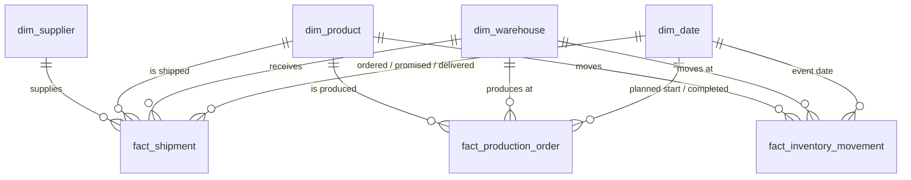

# Database schema

Schemas are created by checksum-verified migrations in [`src/edp/sql/migrations`](../src/edp/sql/migrations). Editing an already-applied migration is detected and refused (`MigrationError`). Changes go in a new numbered file.

## `ops` — operational metadata

| Table | Key | Purpose |
|---|---|---|
| `schema_migrations` | `version` | applied migrations and their SHA-256 |
| `pipeline_runs` | `run_id` | status (`running`, `succeeded`, `failed`, `abandoned`), file and record counts, error |
| `ingested_files` | `file_id`; unique `(entity, checksum_sha256)` | file manifest with per-file row accounting and schema drift |
| `quarantine` | `quarantine_id`; unique `(file_id, row_number)` | rejected rows: `reason_codes text[]`, `issues jsonb`, original `payload jsonb` |
| `dq_results` | `result_id` | file-level (`file_id` set) and dataset-level (`file_id` null) checks with severity, observed value, threshold |
| `model_watermarks` | `model_name` | last `staging.change_seq` consumed by each mart model |

## `raw`

| Table | Key | Purpose |
|---|---|---|
| `landed_records` | `(file_id, row_number)` | every source row as received (JSONB), for audit and replay |

## `staging` — typed current state

All staging tables share these lineage columns:

| Column | Type | Meaning |
|---|---|---|
| `_record_hash` | char(64) | SHA-256 of the cleaned values; used for duplicate detection |
| `_file_id` | bigint → `ops.ingested_files` | file that last wrote the row |
| `_run_id` | uuid | run that last wrote the row |
| `_change_seq` | bigint | from `staging.change_seq`; set on every insert/update |
| `_loaded_at` | timestamptz | when the row was last written |

| Table | Natural key | Foreign keys | Versioned by |
|---|---|---|---|
| `suppliers` | `supplier_id` | — | `updated_at` |
| `warehouses` | `warehouse_id` | — | `updated_at` |
| `products` | `product_id` | `primary_supplier_id` → suppliers | `updated_at` |
| `production_orders` | `production_order_id` | `product_id`, `warehouse_id` | `updated_at` |
| `inventory_movements` | `movement_id` (uuid) | `product_id`, `warehouse_id` | immutable |
| `shipments` | `shipment_id` | `supplier_id`, `product_id`, `warehouse_id` | `updated_at` |

Foreign keys and `CHECK` constraints are declared in staging as well as validated in Python. The Python checks produce friendly quarantine reasons. The constraints are a backstop: if a bug ever let a bad row through, the transaction would fail loudly instead of corrupting data.

## `mart` — star schema

| Table | Type | Grain | Notes |
|---|---|---|---|
| `dim_date` | dimension | day, 2020–2035 | `week_start`, ISO week, weekend flag |
| `dim_supplier` | dimension (SCD1) | supplier | stable `supplier_key` |
| `dim_warehouse` | dimension (SCD1) | warehouse | stable `warehouse_key` |
| `dim_product` | dimension (SCD1) | product | current `unit_cost`, `reorder_point` |
| `fact_production_order` | accumulating snapshot | production order | planned vs actual hours, delays, `is_on_time` |
| `fact_shipment` | accumulating snapshot | inbound shipment | `lead_time_days`, `delay_days`, `is_on_time`, `is_in_full` |
| `fact_inventory_movement` | transaction | stock movement | signed `quantity_delta` |

## KPI views

| View | Grain | Key measures |
|---|---|---|
| `v_data_as_of` | one row | latest timestamp in the data; overdue measures use this |
| `v_production_performance` | week × category | plan attainment, scrap rate, on-time completion, cycle hours |
| `v_inventory_position` | product × warehouse | on hand, stock value, 30-day issue rate, days of cover, stockout, below reorder |
| `v_supplier_scorecard` | supplier | on-time %, in-full %, OTIF %, lead time, days late, defect rate, open/overdue |
| `v_shipment_delays` | delay bucket | delivered shipments by days late |
| `v_operational_kpis` | one row | headline KPIs including quarantine rate |
